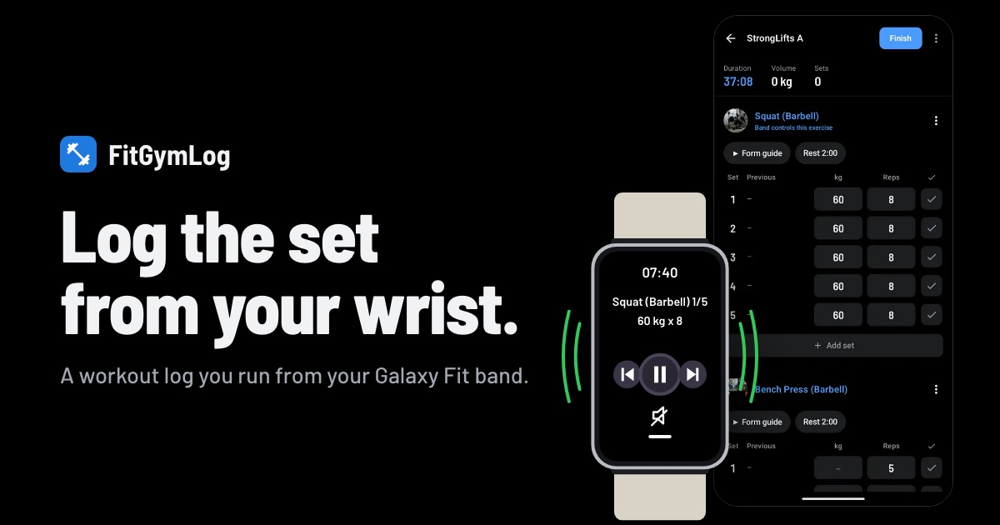
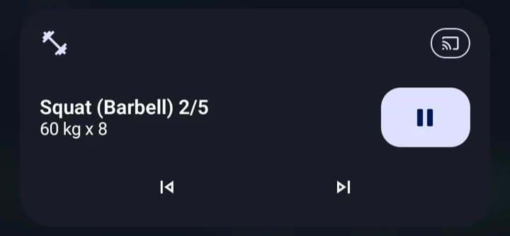

# FitGymLog



A workout log for Android that you can run from a Galaxy Fit band. Press play on the band to complete a set, feel a buzz
when rest is over, and load the bar by tapping plates.

Guide and screenshots: https://wonjoonseol.github.io/fitgymlog/ (한국어: https://wonjoonseol.github.io/fitgymlog/ko/)
Download: [latest release](https://github.com/wonjoonSeol/fitgymlog/releases/latest)

- Band remote through the music controls, and a rest-over buzz on the wrist
- Plate-by-plate weight entry and a reps number pad
- Cardio in minutes (treadmill with speed and incline, stair machine, bike, rower with distance), planned in routines, each saved to
  Health Connect as its own session, with the treadmill's speed and the distance covered
- Ready-made programs (StrongLifts 5x5, full body, upper/lower, push/pull/legs), plus your own routines
- An optional coach on your own API key for an OpenAI-compatible provider over https, or a local model such as Ollama
  over http on the phone or your network: today's targets checked against
  StrongLifts rules, notes after each workout, and a chat that remembers what you let it, sees how long you have
  trained and rested, and can change the workout in progress (weights, sets, rest, exercises in or out) once you apply it
- A Stats tab: workouts, time or volume each week; a weight trend that evens out day-to-day swings, with its weekly
  pace, from Health Connect or typed in; body composition (body fat, fat mass, lean mass, skeletal muscle, visceral
  fat) typed in or, with the coach on, read from a scale or InBody screenshot, compared scan to scan; and each exercise's records and progress
  chart (heaviest set, estimated 1RM, reps or time), with new records marked in History
- A weekly check-in on the last evening of each week: workouts, time and volume against last week, new records, missed reps
  and the weight trend; with the coach on, it can suggest changes to your routines for next week
- An optional warm-up set: 5 reps on the empty bar before each barbell lift
- Fix a finished workout's start and end, for the day you forgot to tap finish
- Form guide videos and articles for the built-in lifts; add any YouTube or web link
- Two-pane layouts on an unfolded Galaxy Fold
- Health Connect (Samsung Health), optional Google Drive sync, Hevy and Strong CSV import and export
- English and Korean

Android 13 or newer. Tested with a Galaxy Fit3 and a Galaxy Z Fold.

## How the band controls the app

The Galaxy Fit3 cannot run third-party apps, but its music screen controls whatever is playing on the phone. FitGymLog
uses that screen as a remote.

1. **A media session with nothing playing.** While a workout is open, `WorkoutService` (a foreground service of type
   `mediaPlayback`) holds an active `MediaSession` in the `PLAYING` state. No audio is played. The session advertises
   play, pause, next and previous.
2. **The set is the song.** The session's metadata carries the current set: the title is the exercise and set
   ("Squat (Barbell) 1/5"), the artist is what to lift ("60 kg x 8"), the album is the workout. The band shows the
   title and artist on its music screen.
3. **Buttons become workout actions.** Galaxy Wearable sends the band's presses to the phone as media transport
   controls on the active session, so they arrive in `MediaSession.Callback`:

   | Band button | Callback | What FitGymLog does |
   |---|---|---|
   | Play or pause | `onPlay`, `onPause` | Completes the set the band is showing and starts the rest timer |
   | Next | `onSkipToNext` | Moves to the next exercise, wrapping to the first |
   | Previous | `onSkipToPrevious` | Takes one rep off the set on the band; below zero it goes back to the planned reps |

   The screen and the band both pass the set they expect to complete, so a tap and a band press at the same moment
   cannot complete two sets.
4. **Rest on the band.** While resting, the title counts down ("Rest 1:55") over the set just done, which is the set
   previous corrects. The title changes in five-second steps timed to the end of the rest, so the band gets few updates.
   The session's duration is the rest length and its position runs at normal speed from 0:00, so the band's progress
   ring around the pause button fills as the rest goes by, like a song, without the app sending it anything per second.
5. **The buzz.** When rest ends, an exact alarm (`AlarmManager.setExactAndAllowWhileIdle`) fires `RestOverReceiver`,
   which posts a high-priority notification with vibration. Galaxy Wearable forwards notifications from apps switched
   on in its Notifications settings, so the band buzzes and shows the next set.

**On the phone, by design:** because the workout is a playing media session, the phone treats it like music. On One UI
the current set shows as a chip at the top left of the status bar, and tapping it opens the media player with previous,
pause and next; tapping the player opens FitGymLog. That player, the lock screen controls and the notification shade all drive the same session as the
band, so pause there completes a set too.



**The catch:** Android sends media buttons to the app that started playing most recently. With YouTube Music,
Spotify or a video playing, the band's buttons can switch between that app and FitGymLog. The rest buzz is a
notification, so it always arrives.

**Testing without a band:** the media player in the notification shade uses the same transport controls, so it stands
in for the band on an emulator. `adb shell cmd media_session dispatch` sends media key events instead, which do not
reach a session that plays no audio.

## Your data

Workouts are stored on the phone. There is no account, no ads and no analytics. Health Connect writes and Google Drive
sync are optional; sync keeps one file in the app's hidden folder of your own Drive. If you also let it read exercise
from Health Connect, it skips a cardio block your band already recorded. Hevy and Strong CSV import and
export mean you can leave at any time.

The coach is off until you turn it on and connect a provider with your own API key, or a model on your own phone or
network, which needs no key. It then sends your recent workouts, today's workout with its rest times, bodyweight, sex, goal,
recent body measurements, the calorie target the app works out, messages with the names of the exercises in the app, your
routines when you ask about a week in the check-in, and, if you allow it, saved notes to the provider or model you chose,
and nothing to the developer. A scale or InBody screenshot you ask it to read goes there too, and so
do the recent body measurements it reads from Health Connect if you allow that. Height and birth date are only used on the
phone for that calorie target. The key is
encrypted with the Android Keystore and left out of backups. Coach notes, workout notes and body measurements can also go into Drive, as a second file in the
same hidden folder. See the [privacy policy](https://wonjoonseol.github.io/fitgymlog/privacy.html).

## Building

Requires JDK 17 and the Android SDK.

```sh
./gradlew testDebugUnitTest lintDebug assembleDebug
```

A release build is signed with the key described in `~/.android/fitgymlog/signing.properties` when that file exists,
and with the debug key otherwise.

## 한국어

Galaxy Fit 밴드로 조작하는 Android 운동 기록 앱입니다. 밴드는 다른 앱을 실행할 수 없지만 휴대폰의 음악을 조작할 수 있어서,
FitGymLog는 운동 중에 소리 없이 "재생 중"인 미디어 세션을 열어 둡니다. 지금 세트가 곡 제목과 아티스트 자리에 보이고,
재생/일시정지는 세트 완료, 다음은 다음 운동, 이전은 횟수 하나 빼기로 받습니다. 휴식 중에는 제목에 남은 시간이 5초 단위로(1:55, 1:50)
보이고, 휴식 시간이 곡 길이가 되어 일시정지 버튼 둘레의 진행 링이 음악처럼 채워집니다. 휴식이 끝나면 정확한 알람으로 알림을 띄우고,
Galaxy Wearable이 이 알림을 밴드로 보내 진동합니다. 그래서 휴대폰에서도 음악처럼 보입니다. 상태 표시줄 왼쪽 위에 지금 세트가
뜨고, 누르면 미디어 플레이어가 열리며 플레이어를 누르면 FitGymLog가 열립니다. 이 플레이어와 잠금 화면 조작도 밴드와 똑같이 동작하는 의도된 설계입니다. 다른 앱이
음악이나 영상을 재생하면 버튼이 그 앱과 오갈 수 있습니다.

## License

[MIT](LICENSE). The bundled Barlow Semi Condensed font is under the SIL Open Font License 1.1, see
[third_party/barlow/OFL.txt](third_party/barlow/OFL.txt).

## Try my other projects

Like this? I make other small open source tools too: Android apps, a Claude chat game, Claude add-ons and more. See them all at [wonjoonseol.github.io](https://wonjoonseol.github.io/?from=fitgymlog).
